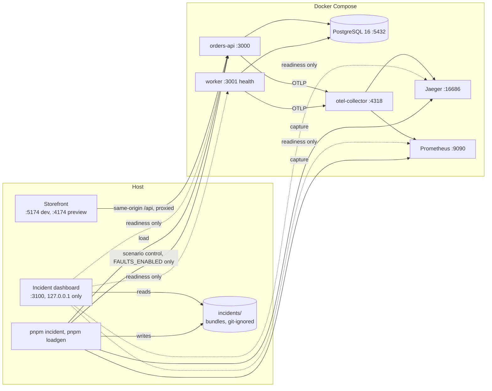

# Architecture

## Goal

Run a believable commerce workload locally, inject faults on demand, and export what an on-call engineer would see, plus the ground truth of what actually broke.

## Components

Each component appears only in the milestone that gives it real code.

| Component                  | Milestone | Responsibility                                                                                            | Does not                                                  |
| -------------------------- | --------- | --------------------------------------------------------------------------------------------------------- | --------------------------------------------------------- |
| `apps/orders-api`          | M1        | Fastify HTTP API for catalog and orders. Writes orders as `pending`.                                      | Process orders inline.                                    |
| `apps/worker`              | M1        | Claims due orders for free slots only, reserves stock, charges through the payment simulator, reconciles. | Serve public traffic. It exposes health endpoints only.   |
| `packages/db`              | M1        | SQL migrations, migration runner, connection pool factory, data-access functions.                         | Contain business rules.                                   |
| `apps/loadgen`             | M4        | Seeded, deterministic traffic profiles against the orders API.                                            | Inspect internal state.                                   |
| `packages/telemetry`       | M3        | OpenTelemetry SDK setup and shared metric names for both apps.                                            | Know about business logic.                                |
| `packages/faults`          | M5        | Scenario registry and injection hooks. Inert unless enabled.                                              | Change behavior by default.                               |
| `apps/incident`            | M5        | Incident CLI: runs a scenario end to end and writes an incident bundle.                                   | Analyze or diagnose incidents.                            |
| `packages/incident-bundle` | M5        | Bundle schema, validator and writer.                                                                      | Know about scenarios.                                     |
| `apps/web`                 | M7        | Read-only incident dashboard (Fastify JSON API plus React client) over the bundles and component health.  | Start runs or change fault state.                         |
| `apps/commerce-web`        | M7        | Storefront: product search, order form, order history, live order status (static React client).           | Contain business rules. It uses only the public HTTP API. |

Pure order and pricing rules start inside the app that uses them. They move to a shared package only if a second consumer appears.

## Runtime topology

Compose services: `postgres`, one-shot `migrate` and `seed` services, `orders-api` on port 3000, and `worker` with health on port 3001. The apps start after the seed completes. Compose health checks call `/readyz`, so "healthy" means the service can reach Postgres. An init script in `infra/postgres/init` creates the `commerce_test` database used by integration tests. M3 adds `otel-collector`, `jaeger` for traces, and `prometheus` for metrics. Logs stay JSON on stdout, with `trace_id` and `span_id` from M3. From M5b, logs are not exported through the collector: the incident tool's capture clients read Jaeger, Prometheus and container logs, and the bundle writer writes the telemetry files. See `docs/prompts/m5-design.md`.

```
loadgen -> orders-api -> postgres <- worker
                 \           |         /
                  ---> otel-collector ---> jaeger, prometheus   (M3+; read by the M5 incident capture)
```

## Runtime view

What runs where, as of 2026-10-27. Compose runs the backend and telemetry; the two UIs and the CLIs run on the host.



**Request flow.** A storefront order is `POST /api/orders` to the orders API (same-origin proxy in dev and preview), inserted as `pending`; the worker claims it, reserves stock, charges through the in-process payment simulator and finalizes it. The storefront polls `GET /orders/:id` every 2 seconds until `paid` or `failed`.

**Incident flow.** `pnpm incident run` applies seeded load, starts a fault through the scenario control endpoints, waits for the primary symptom, captures traces (Jaeger), metrics (Prometheus) and container logs, stops the fault, and writes and validates a bundle. The dashboard only reads the finished bundles and the components' readiness endpoints.

**Storage.** PostgreSQL holds the `products` catalog (with stock), `orders` (including the stock reservation timestamp), `order_items` and the `payment_charges` ledger; migrations are plain forward-only SQL in `packages/db`. Telemetry lives in Jaeger and Prometheus memory and is not durable. Bundles are files under `incidents/`.

**Error handling and resilience.** The worker logs and retries database errors rather than crashing, retries unknown payment outcomes with backoff, reconciles with a lookup that can void, parks unresolved orders in `payment_unknown`, and fences stale claims with `processing_attempts`. Telemetry failures never change order outcomes or health. Configuration is validated with Zod at startup and an unsafe combination stops the service.

**Observability.** JSON logs carry `trace_id` and `span_id`; every worker pass is its own trace, linked to the order's creation trace; Prometheus metrics use low-cardinality labels. Health is `GET /healthz` (process) and `GET /readyz` (can reach Postgres), and the dashboard's health page shows each component's own endpoint.

**Security boundaries.** There is no authentication and no real payment: this is a local development system with development credentials (`commerce` / `commerce`). `compose.yaml` publishes ports on all interfaces; `compose.faults.yaml` binds the API, worker, Jaeger and Prometheus to `127.0.0.1` (Postgres and the collector are not rebound). The dashboard binds `127.0.0.1` and accepts only loopback upstream URLs. Fault controls exist only when `FAULTS_ENABLED=true`. Nothing calls an external network service.

**Start and test.** `docker compose up -d --build --wait`, then `pnpm web` and `pnpm commerce:preview` on the host; tests need the Compose Postgres. See the [README](../README.md).

## Order processing

Background work is the processing of an order, so the order row is the unit of work. There is no generic jobs table. ADR 0002 records why. The full M2 protocol is in `docs/prompts/m2-design.md` and ADR 0005.

1. The client places an order with `POST /orders`. The API inserts it as `pending` with its items and price snapshot. Stock is not checked at this point.
2. The worker claims only as many due orders as it has free slots (`WORKER_CONCURRENCY`) and starts each one at once. A claim increments `processing_attempts`, which is the pass's fencing token.
3. A charge pass reserves stock in one transaction, records the charge attempt, calls the simulator outside any transaction, and finalizes with a fenced update:
   - approved becomes `paid`;
   - declined becomes `failed`, with stock released;
   - an unknown outcome retries with backoff.
4. Once the charge budget is spent, passes only reconcile with `lookupOrVoid`. A recorded approval pays the order. A void fails it and releases stock. Lookup errors back off, then park the order in `payment_unknown` with its stock still reserved.
5. Expired claims and shutdown releases return orders to `pending`, or to `payment_unknown` if parked. Neither changes counters or stock.
6. From M3, the order stores its creating request's trace context. Each worker pass starts its own trace, linked to that context, so a request and every pass on its order can be found together without keeping one trace open for hours. See `docs/prompts/m3-design.md`.

Status transitions, enforced in code and by a trigger: `pending -> processing`, `payment_unknown -> processing`, and `processing -> paid | failed | pending | payment_unknown`.

## Extension points kept open in M1

- **Telemetry:** each app has a single entrypoint that builds everything through factories. M3 preloads OpenTelemetry with `node --import`, so Fastify and `pg` can be auto-instrumented without restructuring.
- **Logging:** both apps use pino through Fastify, so M3 adds `trace_id` and `span_id` through a pino mixin that reads the active span.
- **Resilience baseline:** the worker logs and retries database errors instead of crashing, and the pool handles idle-client errors. Outage incidents in M5 therefore show up as degraded behavior, not as crash loops.
- **Faults:** the pool, payment simulator, clock, and random source are injected. M5 can wrap them without touching call sites.
- **Determinism:** no hidden `Date.now()` or `Math.random()` in logic that affects order outcomes from M2 onward.

## Frontend readiness

Two React UIs now exist, both started early by the owner's decision (see M7 in the roadmap): the storefront and the incident dashboard described below. Proposed ADR 0008 records the project order, and ADR 0004 the API-first rules that follow. The backend is built so a UI needs no change to business logic.

- **Business rules stay in the backend.** Pricing, stock, and lifecycle rules live in the API and worker. The UI only displays state and submits requests.
- **Contracts are presentation-neutral.** Responses are JSON with stable field names, ISO 8601 timestamps, and integer cents. Any text a user sees is chosen by the UI, not returned by the API.
- **Errors are machine-readable.** Every error has the shape `{ error, message, details? }`, with a stable `error` code the UI can map to its own text.
- **Status is readable without guessing.** Order responses include the status, failure reason, and attempt count, so the UI can show progress by polling `GET /orders/:id`.
- **Lists are paginated with cursors,** so order history and catalog views scale.
- **Demo scenarios use the same API as everything else.** The M5 scenario control endpoints list, start, stop, and report on scenarios, and exist only when `FAULTS_ENABLED=true`.
- **No UI concerns leak into the backend.** The storefront uses a same-origin `/api` proxy, so the orders API has no CORS and serves no static files.

**M7 Commerce UI.** `apps/commerce-web` is a static React client (TypeScript, Vite, Tailwind CSS) that uses only the public orders API: `GET /products`, `POST /orders` with an `Idempotency-Key` per distinct submission, `GET /orders` and `GET /orders/:id`. It keeps no business rules: its input checks mirror the API's request schema, and the API's `400` and `422` answers are mapped back onto the form. It polls `GET /orders/:id` every 2 seconds, one request at a time, until `paid` or `failed`, backing off up to 30 seconds on transient failures. The browser calls same-origin `/api`, which the Vite dev and preview servers proxy to the API, so the API adds no CORS or static file serving. The API has no customer identity, so `GET /orders` lists every order, newest first by `(created_at, id)`, with the last order's ID as the cursor; it sorts without a dedicated index, which is enough for local data sets. Each row carries its first three items by SKU, so the history needs no request per order. Optional `status` and `q` (an order-ID prefix, or part of an item's SKU or name, with LIKE wildcards matched literally) filter before the page is cut, so search covers every order; the UI starts again from the first page whenever they change. Product search needs no API change: the UI reads the catalog once through `GET /products` (100 per page, at most 5,000 products), then matches names and SKUs locally. Fault and scenario controls are not part of this UI.

A first slice started early, by the owner's decision (`docs/roadmap.md`, M7): `apps/web`, a host-side, read-only incident dashboard that reads the bundles under `INCIDENTS_DIR` and serves only `127.0.0.1`. It does not use or change the orders API, so the rules above are unaffected. Its stack is React and TypeScript, built with Vite and styled with Tailwind CSS. A Fastify server in `apps/web` serves the built client and a GET-only JSON API: `/api/incidents`, `/api/incidents/:id`, `/api/incidents/:id/telemetry` (the symptom series, log summary and sample traces derived from the bundle's own files) and `/api/incidents/:id/files/:file` for the five bundle files only. `/api/health` reads each component's own readiness endpoint (orders API and worker `/readyz`, Prometheus `/-/ready`, the Jaeger UI) and `GET /admin/scenarios/active`, live, at request time; every upstream must be an http URL on `127.0.0.1` or `[::1]`. The dashboard cannot start or stop scenarios.

## Fault scenarios

A scenario has a name, a seed, a start trigger, a duration, and a ground-truth description. **Implemented** (`pnpm incident list`; details in [incidents-and-handoff.md](incidents-and-handoff.md)): `provider-outage`, `payment-timeouts`, `api-pool-exhaustion`, `bad-deploy-order-reads` and `poison-order`. The list below is the original set of ideas; those not named above are **not** implemented:

- Slow query from a missing index on a growing table.
- Connection pool exhaustion under load.
- Payment simulator timeouts and retry storms.
- Poison order that fails processing repeatedly and starves other orders.
- Stuck claims after a worker crash, leaving orders in `processing`.
- Payment provider lookup outage, parking orders in `payment_unknown` with stock held.
- Bad deploy simulated by a config flag that raises error rates on one endpoint.

From M5a, `FAULTS_ENABLED=true` only makes the scenario control endpoints exist. A scenario starts only through those endpoints, never through an environment variable, and expires on its own. From M5c, `compose.faults.yaml` enables them with the fault-control ports bound to loopback, and `pnpm incident run` refuses to start unless its local-isolation checks pass (`docs/prompts/m5c-design.md`).

## Incident bundle contract

The only interface with the agent repository. One directory per run:

```
incidents/<scenario>-<seed>-<timestamp>/
  manifest.json      # scenario, seed, time window, versions, schema version
  traces.jsonl       # OTLP JSON spans
  metrics.jsonl      # metric samples
  logs.jsonl         # structured logs
  ground_truth.json  # root cause, affected components, expected remediation
```

The bundle schema is versioned. Breaking changes require a new major version and an ADR.

## Boundaries and rules

- Apps depend on packages. Packages never depend on apps.
- Only the fault package decides whether a fault is active. Call sites ask it. They do not read environment variables directly.
- No component calls an external network service.
